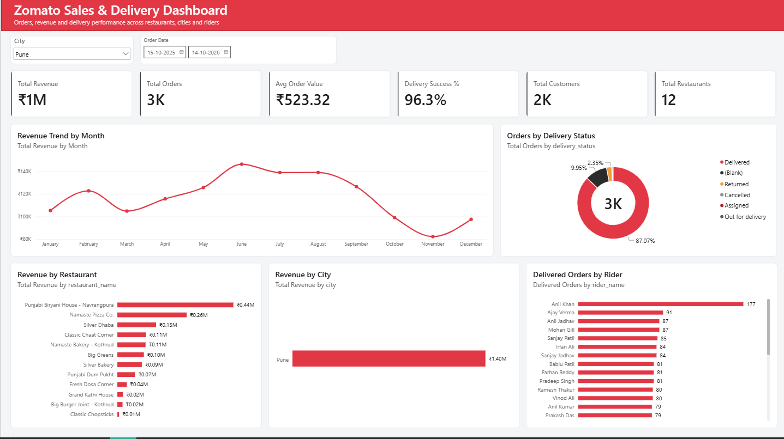

# Zomato Sales & Delivery Analytics

An end-to-end analytics case study for a Zomato-style food delivery platform. It combines **22 PostgreSQL business analyses** with an interactive **Power BI executive dashboard** to explore revenue, customers, restaurants, and delivery performance.

## Dashboard preview



The dashboard brings core business indicators together in one view, with city and order-date filters, revenue trends, delivery status, restaurant and city revenue, and rider delivery volumes.

## Project highlights

- Answered 22 business questions using a five-table relational model.
- Applied SQL techniques including joins, CTEs, window functions, conditional aggregation, date/time calculations, ranking, and customer segmentation.
- Built a Power BI overview with KPI cards, interactive filters, and focused performance visuals.
- Modeled orders, customers, restaurants, deliveries, and riders, with DAX measures for business metrics.
- Reviewed and corrected query logic for cancellation rates, weekday aggregation, rider earnings, and fastest/slowest rider identification.

## Business questions explored

The SQL analysis covers data quality, repeat and high-value customers, popular dishes, order timing, restaurant revenue, city trends, delivery gaps, cancellation rates, delivery duration, rider performance and earnings, customer lifetime value, monthly growth, and seasonal order volume.

See [`queries.sql`](SQL_queries.sql) for the numbered questions and solutions.

## Dashboard metrics

| Metric | Definition |
| --- | --- |
| Total Revenue | Sum of order amounts |
| Total Orders | Distinct order count |
| Average Order Value | Revenue divided by orders |
| Delivery Success | Delivered deliveries as a share of all deliveries |
| Total Customers | Distinct customer count |
| Total Restaurants | Distinct restaurant count |

## Technology

**PostgreSQL** · **Power BI** · SQL · DAX · Power Query (M)

SQL techniques include CTEs, window functions (`RANK`, `DENSE_RANK`, `LAG`), conditional aggregation, joins, `CASE` expressions, and date/time arithmetic.

## Data model

The project uses five core tables: `orders`, `customers`, `restaurants`, `deliveries`, and `riders`. Orders are the central fact table; customer and restaurant details connect to orders, while deliveries connect orders to riders.

## Repository contents

```text
zomato_sqlProject/
├── README.md
├── queries.sql
├── zomato_dashboard.pbip
├── zomato_dashboard.Report/
└── zomato_dashboard.SemanticModel/
```

## Run the project

### SQL analysis

1. Set up PostgreSQL and create/load the five tables described above.
2. Open `queries.sql` in your SQL client.
3. Run the numbered questions individually or in sequence, using a database with the expected schema and columns.

### Power BI dashboard

1. Open `zomato_dashboard.pbip` in Power BI Desktop.
2. Configure the PostgreSQL connection for your local `zomato_db` database.
3. Refresh the model to load your data.


**Portfolio project** · Food delivery analytics · SQL + Power BI
